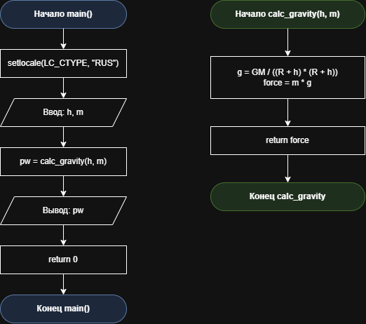

# Домашнее задание к работе 3

## Условие задачи
Написать и отладить программу вычисления силы тяжести при
падении с заданной высоты тела заданной массы.

## 1. Алгоритм и блок-схема

### **Алгоритм**
1. **Начало**
2. Подключить необходимые библиотеки и задать константы:
   - `<locale.h>` - для работы с локалью (поддержка русского языка).
   - `<stdio.h>` - для ввода и вывода данных (puts, scanf, printf).
   - Определить константы препроцессора: радиус Земли `R = 6371000.0` и гравитационный параметр `GM = 3.986004418e14`.
3. Объявить прототип функции `double calc_gravity(double h, double m)` для расчёта силы тяжести.
4. Определить функцию `main()` - точку входа в программу:
   - Объявить переменные типа double: `h` (высота падения), `m` (масса тела), `pw` (сила тяжести).
   - Установить русскую локаль: `setlocale(LC_CTYPE, "RUS")`.
5. Запросить у пользователя и считать с клавиатуры исходные данные:
   - Ввести высоту падения `h` в метрах.
   - Ввести массу тела `m` в килограммах.
6. Вызвать функцию расчёта `calc_gravity(h, m)`, передав ей аргументы `h` и `m`.
7. В функции `calc_gravity(double h, double m)`:
   - Объявить переменные типа double: `g` (ускорение свободного падения), `force` (сила тяжести).
   - Вычислить ускорение свободного падения на высоте h: `g = GM / ((R + h) * (R + h))`.
   - Вычислить силу тяжести: `force = m * g`.
   - Вернуть вычисленное значение `force` в вызывающую функцию `main()`.
8. В функции `main()` сохранить возвращённое значение в переменную `pw`.
9. Вывести на экран значение силы тяжести с форматированием до двух знаков после запятой (`printf`) и завершить функцию `main()`, вернув 0.
10. **Конец**

### Блок-схема
 

[https://github.com/stzraw/lab-3-VSTU-HW/blob/main/lab_3HW_schema.png](https://github.com/stzraw/lab-3-VSTU-HW/blob/main/lab_3_schema.pravki.png)

## 2. Реализация программы

#define _CRT_SECURE_NO_DEPRECATE
#include <locale.h>
#include <stdio.h>
#include <stdlib.h>

#define R 6371000.0
#define GM 3.986004418e14

double calc_gravity(double h, double m);

int main()
{
    double h, m;
    double pw;

    setlocale(LC_CTYPE, "RUS");

    puts("Введите высоту падения (м):");
    scanf("%lf", &h);

    puts("Введите массу тела (кг):");
    scanf("%lf", &m);
    pw = calc_gravity(h, m);

    printf("Сила тяжести равна: %.2f Н\n", pw);
    return 0;
}

double calc_gravity(double h, double m)
{
    double g;
    double force;

    g = GM / ((R + h) * (R + h));
    force = m * g;
    return force;
}

## 3. Результаты работы программы

Если ввести, например, h=100м и m=10кг, вывод будет: **Сила тяжести равна: 98.20 Н**

## 4. Информация о разработчике

Быханов Александр Андреевич бИД - 262 2пг

