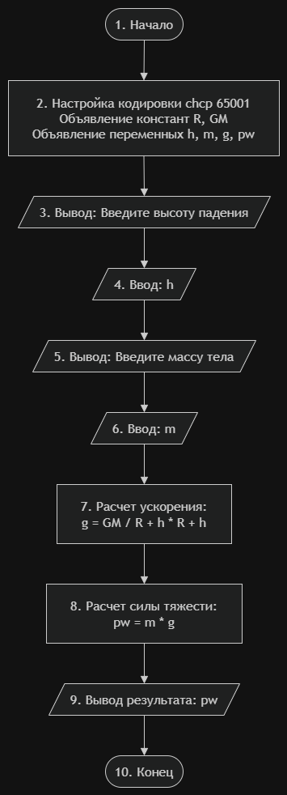

# Домашнее задание к работе 3

## Условие задачи
Написать и отладить программу вычисления силы тяжести при
падении с заданной высоты тела заданной массы.

## 1. Алгоритм и блок-схема

### Алгоритм
1. **Начало**
2. Подключить <locale.h>, <stdio.h>, <stdlib.h>; задать константы R = 6371000.0f (радиус Земли) и GM = 3.986004418e14f (гравитационный параметр).
3. В main() выполнить system("chcp 65001") для корректного отображения кириллицы.
4. Объявить переменные float h, m, g, pw для высоты, массы, ускорения и силы тяжести.
5. Запросить у пользователя высоту и массу через puts + scanf_s.
6. Рассчитать g = GM / ((R + h) * (R + h)) и pw = m * g.
7. Вывести силу тяжести с точностью до 2 знаков: printf("Сила тяжести равна: %.2f Н\n", pw). Вернуть 0 — завершить программу.
8. **Конец**

### Блок-схема
 

https://github.com/stzraw/lab-3-VSTU-HW/blob/main/lab_3HW_schema.png

## 2. Реализация программы

#include <locale.h>
#include <stdio.h>
#include <stdlib.h> 
#define      R       6371000.0f
#define      GM      3.986004418e14f

int main()
{
	system("chcp 65001");

    float h, m, g, pw;
	puts("Введите высоту падения (м):");
	scanf_s("%f", &h);

    puts("Введите массу тела (кг):");
	scanf_s("%f", &m);

    g = GM / ((R + h) * (R + h));
    pw = m * g;
    
	printf("Сила тяжести равна: %.2f Н\n", pw);
	return 0;
}

## 3. Результаты работы программы

при вводимых данных 10 и 10 вывод: **Сила тяжести равна: 98.20 Н**

## 4. Информация о разработчике

Быханов Александр Андреевич бИД - 262 2пг

